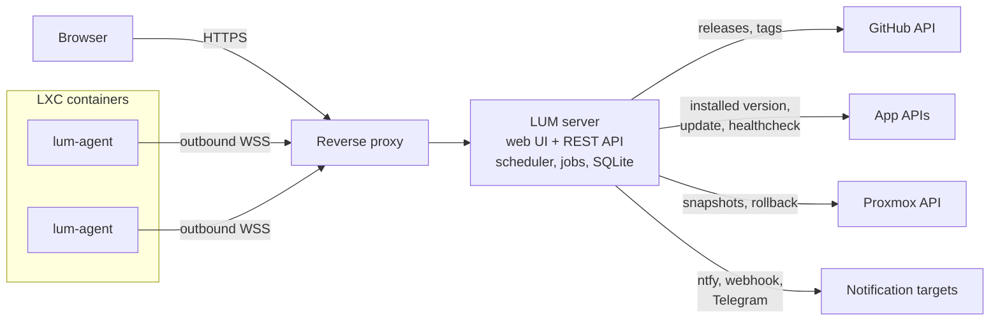

# LUM — LXC Update Manager

LUM is a self-hosted update manager for applications running in Proxmox LXC containers. It detects new GitHub releases of your apps, compares them with the versions actually installed, and notifies you. When you are ready, it can run the update for you: it takes a Proxmox snapshot, triggers the update through the app's own API or a script run by a small agent inside the container, checks that the app is healthy again, and rolls back if something goes wrong.

<!-- TODO screenshot: docs/screenshot.png -->

## Features

- **Version dashboard**: installed vs. latest version for every app, with release notes and check history.
- **GitHub release detection**: releases or tags, optional pre-releases, tag normalization by regex, ETag caching to save the API rate limit.
- **Installed version detection**: from the app's HTTP API (JSONPath), or by running a command inside the container through the agent.
- **Notifications** on new versions, finished updates and offline agents: ntfy, generic webhook, Telegram.
- **One-click updates** from the web UI: through the app's API, or with a checksum-verified shell script run by the agent, with live logs.
- **Safety net**: Proxmox snapshot before the update, healthcheck after, automatic or manual rollback, temporary CPU/memory boost during heavy updates.
- **Lightweight agent**: one static binary per container, outbound WebSocket only (no open port), self-updating.
- **Configuration as YAML** with `${ENV}` secrets and hot reload; state and history in SQLite.
- **Secure by default**: OIDC login (Keycloak or any provider), secrets never exposed, audit log of every action, Prometheus metrics.

## Architecture

The server is the only component users reach. Agents are optional: they are only needed for apps whose version must be read by a command, or that are updated by a script.

## Quickstart

Follow [Getting started](doc/getting-started.md): download the server, write a short configuration, and see your first app's version state in about ten minutes.

## Documentation

1. [Getting started](doc/getting-started.md): first run with one app
2. [Deployment](doc/deployment.md): systemd install, reverse proxy, backup and restore
3. [Configuration](doc/configuration.md): `server.yaml`, `apps.yaml`, `${…}` secrets, validation, hot reload
4. [Version detection](doc/version-detection.md): GitHub releases, installed version, comparison, states
5. [Checks and notifications](doc/checks-notifications.md): schedule, history, ntfy/webhook/Telegram
6. [Proxmox snapshots](doc/proxmox.md): API token, minimal permissions, snapshots and resources
7. [Agents](doc/agent.md): installation, enrollment, heartbeat, script sync, self-update, troubleshooting
8. [Update scripts](doc/scripts.md): writing scripts, variables, output, cancellation
9. [Updates and jobs](doc/updates.md): triggering from the web UI, live logs, failures, rollback
10. [Authentication](doc/authentication.md): OIDC (browser session and Bearer tokens)
11. [REST API](doc/api.md): routes, SSE log stream, errors, audit log, Prometheus metrics

Design documents: [specification](doc/specification.md), [roadmap](doc/ROADMAP.md), [design decisions](DECISIONS.md).

## Glossary

| Term | Meaning |
|---|---|
| **App definition** | An entry of `apps.yaml` describing one application: where to read its installed version, where its releases come from, and how to update it. |
| **Current version** | The version actually installed, read from the app's API or by the agent. |
| **Upstream** | Where the latest version comes from: a GitHub repository's releases or tags. |
| **Agent** | `lum-agent`, a small daemon in an LXC container that reads versions and runs update scripts on the server's orders, over an outbound WebSocket. |
| **Job** | One update run of one app, from snapshot to healthcheck, with its logs and final state. |
| **Snapshot** | A Proxmox LXC snapshot taken before an update, used to roll the container back. |

## Development

See [CONTRIBUTING.md](CONTRIBUTING.md).

## License

[MIT](LICENSE)
