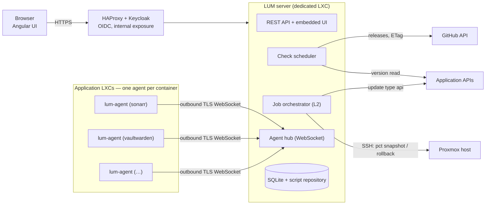
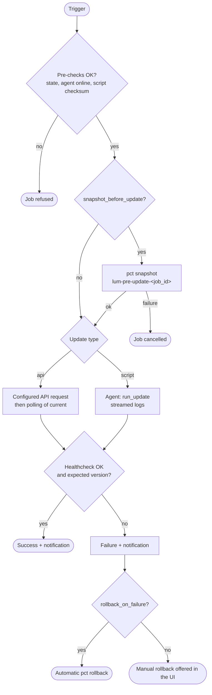

# Specification — LXC Update Manager

Oct 17, 2026

## 1. Context and goals

**LXC Update Manager (LUM)** centralizes viewing and triggering updates of self-hosted applications running in Proxmox LXC containers, when those applications are not managed by the container's package manager (Sonarr, Radarr, Prowlarr, Vaultwarden, etc.).

Goals:

- Show, in a single dashboard, the installed version and the latest available version of each application.
- Trigger updates from the interface, safely (snapshot, healthcheck, rollback).
- Stay fully configurable through YAML files, with no hardcoded configuration.
- Centralize the update scripts and distribute them automatically to the agents.

This document is the reference specification: it is meant to be consumed by generative AIs to carry out the development. Any ambiguity must be resolved in favor of what is written here; anything not specified is left to the implementation's choice, provided it is documented.

## 2. Scope and deliverables

Development is split into two incremental deliverables. Deliverable 2 fully reuses the foundation of Deliverable 1.

| Deliverable | Content | Components delivered |
| --- | --- | --- |
| **L1 — Consultation** | Detection of installed and available versions, read-only dashboard, scheduled checks, notifications | Server (backend + UI), YAML configuration, upstream (GitHub) and current (API, read-only agent) connectors |
| **L2 — Execution** | Triggering updates from the UI, Proxmox snapshot/rollback, job tracking and live logs, script dispatch | Full agent (execution), job orchestrator, script synchronization, history |

Out of scope (both deliverables):

- Applications managed by `apt` or another package manager (Plex, Deluge…).
- Docker containers and virtual machines.
- Updating the LXC operating system (`apt upgrade`).
- Creating or provisioning new LXCs.

## 3. Overall architecture



The server, the only component exposed to users, queries GitHub and the application APIs, drives the Proxmox host over SSH, and receives the agents' outbound connections: no inbound port is opened on the application LXCs.

## 4. YAML configuration

All configuration lives in two files mounted in the server container: `config/server.yaml` (global settings) and `config/apps.yaml` (one definition per application). Secrets are **never** written in these files: every sensitive field accepts the `${ENV_VAR}` syntax, resolved at startup from the environment or a `.env` file. The configuration is hot-reloaded on `SIGHUP` or via `POST /api/v1/config/reload`.

### 4.1 `server.yaml`

```yaml
server:
  listen: "0.0.0.0:8080"
  base_url: "https://lum.example.com"
  log_level: info          # debug | info | warn | error

auth:
  mode: oidc               # oidc | none (none = trusted network only)
  oidc:
    issuer: "https://auth.example.com/realms/example"
    client_id: "lum"
    client_secret: "${OIDC_CLIENT_SECRET}"

github:
  token: "${GITHUB_TOKEN}"   # optional; 60 req/h without, 5000 with
  cache_ttl: 15m             # ETag cache of responses

scheduler:
  check_cron: "0 7 * * *"    # daily version check
  jitter: 5m

notifications:
  - type: ntfy
    url: "https://ntfy.example.com/updates"
    on: [update_available, job_failed, job_success]
  - type: webhook            # e.g. Home Assistant
    url: "${HA_WEBHOOK_URL}"
    on: [update_available, job_failed]

agents:
  shared_secret: "${AGENT_BOOTSTRAP_SECRET}"  # initial enrollment only
  heartbeat_interval: 60s
  offline_after: 5m

scripts:
  dir: "/data/scripts"       # central repository of update scripts
```

### 4.2 `apps.yaml` — one definition per application

Each entry describes how to read the installed version (`current`), how to find the latest version (`upstream`), and how to update (`update`, Deliverable 2). Two update types exist: `api` (the application updates itself through its API) and `script` (a script run by the local agent).

```yaml
apps:
  # ---- API type: the *arr apps update themselves ----
  - id: sonarr
    name: "Sonarr"
    lxc_id: 101                      # Proxmox VMID (informational + snapshot)
    agent: sonarr-lxc                # agent id; required if update.type=script
    upstream:
      type: github
      repo: "Sonarr/Sonarr"
      include_prerelease: false
      tag_regex: "^v?(?P<version>\\d+\\.\\d+\\.\\d+(\\.\\d+)?)$"
    current:
      type: api
      url: "http://192.0.2.15:8989/api/v3/system/status"
      auth_header: "X-Api-Key"
      token: "${SONARR_API_KEY}"
      json_path: "$.version"
    update:
      type: api
      method: POST
      url: "http://192.0.2.15:8989/api/v3/command"
      auth_header: "X-Api-Key"
      token: "${SONARR_API_KEY}"
      body: '{"name": "ApplicationUpdate"}'
    healthcheck:
      url: "http://192.0.2.15:8989/ping"
      expect_status: 200
      timeout: 120s
    snapshot_before_update: true

  # ---- Script type: run by the local agent ----
  - id: vaultwarden
    name: "Vaultwarden"
    lxc_id: 102
    agent: vaultwarden-lxc
    upstream:
      type: github
      repo: "dani-garcia/vaultwarden"
      tag_regex: "^(?P<version>\\d+\\.\\d+\\.\\d+)$"
    current:
      type: agent                    # the agent runs a local command
      command: ["/opt/vaultwarden/vaultwarden", "--version"]
      output_regex: "(?P<version>\\d+\\.\\d+\\.\\d+)"
    update:
      type: script
      script: "vaultwarden.sh"       # name in the central script repository
      timeout: 15m
    healthcheck:
      url: "http://192.0.2.21:8000/alive"
      expect_status: 200
      timeout: 120s
    snapshot_before_update: true
```

Validation rules (at startup and on reload):

- `id` unique, in kebab-case; `lxc_id` a positive integer.
- `update.type: script` requires `agent` and a `script` that exists in `scripts.dir`.
- `current.type: agent` requires `agent`.
- Any unresolved `${…}` variable → blocking error at startup, listing the missing variables.
- An invalid file on reload → the previous configuration stays active, the error is logged and shown in the UI.

## 5. Version detection

### 5.1 Installed version (`current`)

| Type | Mechanism | Fields |
| --- | --- | --- |
| `api` | HTTP GET request to the application's API, extraction by JSONPath | `url`, `auth_header`, `token`, `json_path` |
| `agent` | The local agent runs a command and returns its output; the server extracts the version by regex | `command` (argv array), `output_regex` (named group `version`) |

In Deliverable 1, the `agent` type may be unavailable (agents not deployed): the application is then shown with the `unknown` state for the installed version, without blocking the rest of the dashboard.

### 5.2 Latest available version (`upstream`)

Only the `github` type is required for both deliverables (extensible: `gitlab`, `url_regex`).

- Call `GET /repos/{repo}/releases/latest`, or `GET /repos/{repo}/releases` if `include_prerelease: true` (take the most recent).
- Conditional requests with `ETag` (`If-None-Match`); a `304` response consumes no quota and keeps the cache.
- Tag normalization through `tag_regex`: the named group `version` gives the canonical version (strips prefixes such as `v`, `release-`…).
- Automatic fallback to `GET /repos/{repo}/tags` if the repository publishes no releases.

### 5.3 Comparison

- Versions are compared as extended SemVer: 3 or 4 numeric segments (`4.0.1.2`), a missing segment = `0`.
- States computed per application: `up_to_date`, `update_available`, `unknown` (one of the two versions unreadable), `error` (collection failure, with a message).
- Each check is persisted (timestamp, versions, state, error if any) for the history and for computing "new update detected" (state transition → notification, no re-notification on every check).

## 6. Deliverable 1 — Viewing updates

### 6.1 Features

- **Dashboard**: one row per application with name, LXC, installed version, latest version, state (colored badge), date of the last check, link to the GitHub release notes of the target tag.
- **Scheduled check** according to `scheduler.check_cron`, plus a "Check now" button (global and per application).
- **Application detail**: check history, GitHub release body (rendered markdown), collection errors.
- **Notifications** when a new version is detected (`update_available`) through the configured channels.
- **System status page**: configuration validity, remaining GitHub quota, recent errors.

### 6.2 Acceptance criteria

- [ ] An `api` app and an `agent` app (`unknown` version tolerated) are displayed correctly from the very first start with a valid `apps.yaml`.
- [ ] A full check of 20 applications runs in under 30 s (parallel calls, configurable concurrency limit, default 5).
- [ ] A failure of one application (timeout, 401) does not affect the other rows; the error is visible in the UI.
- [ ] No secret appears in the logs or in API responses (tokens masked as `****`).
- [ ] A notification is sent only on the transition to `update_available`, not on every check.

## 7. Deliverable 2 — Triggering updates

An update is an asynchronous, persisted **job**, with logs viewable live in the UI (SSE). Only one active job per application; concurrent requests are rejected with `409`.

### 7.1 Job flow

The diagram below (section 7.3) details the flow. Steps:

1. **Pre-checks**: app in `update_available` state, agent online (if type `script`), script present and synchronized (checksum).
2. **Snapshot** (if `snapshot_before_update: true`): `pct snapshot <lxc_id> lum-pre-update-<job_id>` over SSH on the Proxmox host. Snapshot failure → job cancelled.
3. **Execution**:
   - Type `api`: the configured request (e.g. `ApplicationUpdate` for the \*arr apps), then polling of `current` until the version changes or a timeout.
   - Type `script`: an order is sent to the agent, which runs the script locally and streams stdout/stderr.
4. **Healthcheck**: polling of `healthcheck.url` until `expect_status` or until `timeout` expires.
5. **Version check**: `current` is read again; the version must be the expected one.
6. **Outcome**: `success` → notification + optional deletion of the snapshot after `retention` (default: keep the last 2); `failed` → notification; **automatic rollback** (`pct rollback`) only if `rollback_on_failure: true` in the app definition (default `false` — a rollback restores the whole container, data included); otherwise a one-click manual rollback is offered in the UI.

### 7.2 Job states

`pending → snapshotting → running → healthchecking → success | failed | rolled_back | cancelled`

Every state is timestamped and logged. A job stuck beyond `update.timeout` moves to `failed` (reason `timeout`).

### 7.3 Detailed flow



If the healthcheck fails or the version is unexpected, the job fails and the snapshot remains available for rollback.

### 7.4 Acceptance criteria

- [ ] End-to-end update of Sonarr (type `api`): snapshot, update, healthcheck, new version displayed.
- [ ] Update of Vaultwarden (type `script`) with the script's logs visible live in the UI.
- [ ] A failed healthcheck produces a `failed` job, a notification, and a working "Rollback" button.
- [ ] Agent offline → the job is refused before any snapshot, with an explicit message.
- [ ] Two simultaneous triggers on the same app → the second receives `409`.

## 8. Local agent and server-agent protocol

The agent is a single static Go binary (`lum-agent`), installed in each relevant LXC and managed by systemd. It opens **no inbound port**: it establishes a persistent outbound connection to the server (WebSocket over HTTPS), which avoids any per-LXC network configuration and works across separate network bridges.

### 8.1 Lifecycle

1. **Enrollment**: on first start, the agent presents itself with `agent_id` + `shared_secret` (bootstrap). The server issues it an **individual token**, persisted locally (`/etc/lum-agent/token`); the shared secret is no longer used afterwards.
2. **Heartbeat**: every `heartbeat_interval`, the agent sends the agent version, hostname, uptime, and the checksums of its local scripts. Without a heartbeat for `offline_after`, the server marks it `offline`.
3. **Commands**: the server pushes orders over the connection; the agent replies asynchronously.

### 8.2 Supported orders

| Order | Role | Response |
| --- | --- | --- |
| `get_version` | Run the app definition's `current.command` | stdout, exit code |
| `sync_scripts` | Receive the scripts (name, content, SHA-256 checksum, mode) and write them to `/opt/lum-agent/scripts/` | list of applied checksums |
| `run_update` | Run an update script with the contractual environment variables | log stream + final exit code |
| `cancel_job` | Kill the running job's process (SIGTERM, then SIGKILL after 30 s) | acknowledgment |
| `self_update` | Download the new agent binary from the server, verify its checksum, replace itself and restart via systemd | version after restart |

### 8.3 Script execution contract

Environment variables provided to the script: `LUM_APP_ID`, `LUM_APP_NAME`, `LUM_CURRENT_VERSION`, `LUM_TARGET_VERSION`, `LUM_JOB_ID`. Exit code `0` = success, anything else = failure. stdout/stderr are captured line by line and sent to the server in real time. The agent runs scripts as root (the LXC services run under dedicated users; the script performs the necessary `su`/`systemctl`).

### 8.4 Installation

A single installation script is provided: `curl -fsSL https://lum.example.com/install-agent.sh | bash -s -- --id sonarr-lxc --secret <bootstrap>`. It places the binary in `/opt/lum-agent/`, creates the systemd unit `lum-agent.service` (restart=always) and starts the service.

## 9. Centralized update scripts

Scripts live only on the server, in `scripts.dir` (ideally a Git clone, for versioning). Agents only hold synchronized copies: **the source of truth is always the server**.

How it works:

- Every `*.sh` file in the repository is indexed at startup and on every change (inotify watcher): name, size, SHA-256 checksum.
- Synchronization is **targeted**: an agent only receives the scripts referenced by the app definitions that concern it.
- Sync triggers: a script change, an agent reconnection, a heartbeat reporting a diverging checksum, the "Synchronize" button in the UI.
- Before each `run_update`, the server checks that the agent's local checksum matches; otherwise it re-synchronizes, then runs. The agent refuses to run a script whose checksum does not match the received order.
- The UI shows, per agent, the list of scripts and their synchronization state (`in_sync`, `stale`, `missing`).

Script-writing conventions (to be documented in the repo, `scripts/README.md`): `#!/usr/bin/env bash`, `set -euo pipefail`, idempotent, logging on stdout, verified downloads (upstream checksum when available), stopping/restarting services via `systemctl`.

## 10. Security

This application de facto has root access to all the LXCs and to the Proxmox host: security is a first-class requirement.

- **Server UI and API**: OIDC authentication (Keycloak). Internal exposure only, behind the reverse proxy. No unauthenticated route except `/healthz` and the agent WebSocket endpoint.
- **Agents**: an individual token per agent, revocable from the UI; TLS mandatory on the connection; the bootstrap `shared_secret` is only used for enrollment and can be disabled (`agents.enrollment: closed`) once all agents are enrolled.
- **Scripts**: only scripts from the central repository, verified by checksum, can be run; the API never allows sending an arbitrary command to an agent.
- **Proxmox access**: a dedicated SSH key to the host, restricted in `authorized_keys` by `command=` to a wrapper that only allows `pct snapshot|rollback|delsnapshot|status`.
- **Secrets**: only through environment variables; masked in logs, the UI and API exports; never sent to agents (application tokens such as `X-Api-Key` stay on the server side).
- **Audit log**: every write action (trigger, rollback, sync, reload) is recorded with the user's OIDC identity.

## 11. Server REST API

Prefix `/api/v1`, JSON, OIDC authentication (Bearer). Endpoints marked L2 only exist in Deliverable 2.

| Method | Route | Role | Deliverable |
| --- | --- | --- | --- |
| GET | `/apps` | List of applications with their current state | L1 |
| GET | `/apps/{id}` | Detail + check history | L1 |
| POST | `/apps/{id}/check` | Force a check | L1 |
| POST | `/checks` | Force the global check | L1 |
| GET | `/system/status` | Config, GitHub quota, errors | L1 |
| POST | `/config/reload` | Reload the YAML configuration | L1 |
| POST | `/apps/{id}/update` | Trigger an update (409 if a job is active) | L2 |
| GET | `/jobs?app={id}&status=` | Job history | L2 |
| GET | `/jobs/{id}` | Job detail | L2 |
| GET | `/jobs/{id}/logs` | Logs as an SSE stream | L2 |
| POST | `/jobs/{id}/cancel` | Cancel a running job | L2 |
| POST | `/jobs/{id}/rollback` | Roll back to the job's snapshot | L2 |
| GET | `/agents` | List of agents, state, version, script sync | L2 |
| POST | `/agents/{id}/sync-scripts` | Force script synchronization | L2 |
| POST | `/agents/{id}/revoke` | Revoke an agent's token | L2 |

Uniform error format: `{"error": {"code": "agent_offline", "message": "…"}}` with the appropriate HTTP status code.

## 12. Data model

**SQLite** persistence (single file `/data/lum.db`, WAL enabled), migrations embedded in the binary and applied at startup. The configuration (YAML) is never duplicated in the database: the database only stores state and history, with logical foreign keys on `app_id` (a string from the YAML).

| Table | Main columns | Role |
| --- | --- | --- |
| `version_checks` | id, app\_id, checked\_at, current\_version, latest\_version, status, error, release\_url, release\_notes | Check history (90-day retention) |
| `app_state` | app\_id (PK), status, current\_version, latest\_version, last\_check\_at, last\_notified\_version | Denormalized current state for the dashboard |
| `jobs` | id (UUID), app\_id, type (api/script), status, target\_version, snapshot\_name, created\_by, created\_at, started\_at, finished\_at, error | Update jobs (L2) |
| `job_logs` | job\_id, seq, ts, stream (stdout/stderr/system), line | Line-by-line logs (L2, 90-day retention) |
| `agents` | id (PK), token\_hash, agent\_version, hostname, last\_seen\_at, status, enrolled\_at, revoked | Enrolled agents (L2) |
| `agent_scripts` | agent\_id, script\_name, checksum, synced\_at | Script synchronization state (L2) |
| `audit_log` | id, ts, user, action, target, details | Audit log of writes |

## 13. Non-functional requirements

- **Logs**: structured JSON on stdout (journald-compatible), level set by `log_level`; correlation by `job_id` / `app_id`.
- **Notifications**: generic `ntfy` and `webhook` (JSON POST) channels; events `update_available`, `job_success`, `job_failed`, `agent_offline`. Interface-based architecture to add other channels.
- **Scheduling**: internal cron (a robust library such as robfig/cron), configurable jitter, no dependency on a system cron.
- **Robustness**: the server restarts cleanly with jobs in progress → jobs marked `failed` (reason `server_restart`); agents reconnect automatically with exponential backoff (1 s → 60 s).
- **Backup**: all state fits in `/data` (SQLite + scripts) and `config/`; document the restore procedure.
- **UI**: French, responsive (mobile viewing), light/dark theme following the system.
- **Performance**: target scale ≤ 50 applications and ≤ 30 agents; no optimization beyond that is required.
- **Observability**: Prometheus `/metrics` endpoint (checks, jobs, online agents, remaining GitHub quota).

## 14. Tech stack and development plan

### 14.1 Stack

- **Server and agent backend**: Go ≥ 1.23, static binaries (`CGO_ENABLED=0`; SQLite via `modernc.org/sqlite`). Suggested libraries: `chi` (HTTP), `nhooyr.io/websocket`, `google/go-github`, `robfig/cron`, `golang.org/x/crypto/ssh`.
- **Frontend**: Angular ≥ 19, standalone components, signals; served by the Go binary (embed). REST + SSE communication.
- **Monorepo**:

```
lum/
├─ cmd/server/          # server main
├─ cmd/agent/           # agent main
├─ internal/config/     # YAML parsing + validation
├─ internal/upstream/   # latest-version connectors (github)
├─ internal/current/    # installed-version connectors (api, agent)
├─ internal/jobs/       # L2 orchestrator
├─ internal/agenthub/   # server WebSocket + protocol
├─ internal/proxmox/    # SSH pct snapshot/rollback
├─ internal/store/      # SQLite + migrations
├─ web/                 # Angular app
├─ scripts/             # update script repository (examples included)
└─ deploy/              # systemd units, install-agent.sh, example config
```

### 14.2 Milestones for AI-assisted development

Each milestone is deliverable, testable on its own, and finished with: passing unit tests (`go test ./...`), a clean `golangci-lint`, an updated `README`. Implement in this order, without anticipating the next milestone:

1. **M1** — `internal/config`: models, parsing, validation, `${ENV}` substitution, tests on valid/invalid files.
2. **M2** — `internal/upstream` + `internal/current` (type `api`) + version comparator, with test HTTP servers.
3. **M3** — `internal/store` + scheduler + notifications: persisted checks, state transitions.
4. **M4** — REST API L1 + Angular UI (dashboard, detail, system status). **End of Deliverable 1.**
5. **M5** — Agent: WebSocket connection, enrollment, heartbeat, `get_version`, `sync_scripts`.
6. **M6** — `internal/proxmox` (snapshot/rollback over SSH, restricted wrapper) + job orchestrator for type `api`.
7. **M7** — Type `script` jobs: `run_update`, log streaming, cancellation, agent `self_update`.
8. **M8** — REST API L2 + UI (trigger, SSE logs, agents, rollback) + audit. **End of Deliverable 2.**

Rules for the implementing AI: strictly follow the contracts (YAML §4, orders §8.2, API §11, tables §12); any necessary deviation is recorded in a `DECISIONS.md` file at the repository root; never introduce a hardcoded secret, including in tests.
